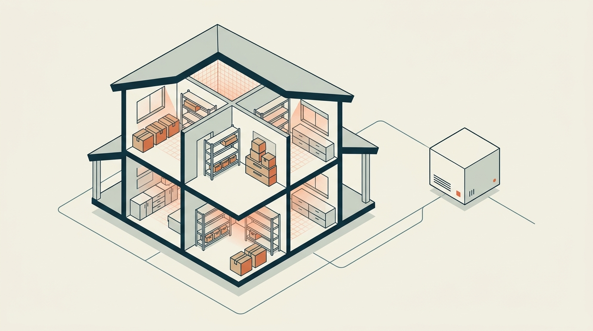
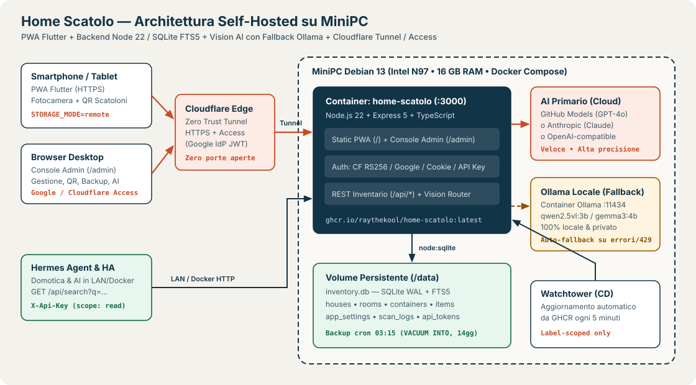

# 📦 Home Scatolo

> **Inventario domestico intelligente, self-hosted sul tuo MiniPC** — fotografa armadi, scatoloni, scaffali e cassetti, lascia che l'AI riconosca gli oggetti (cloud primario + fallback locale Ollama) e ritrova tutto in un secondo da smartphone, console web `/admin`, **Hermes Agent** o **Home Assistant**.



[](app/)
[](backend/)
[](docker-compose.minipc.yml)
[](documentation/DOCUMENTAZIONE_TECNICA.md#-pipeline-vision-ai--fallback-automatico)
[](documentation/DOCUMENTAZIONE_TECNICA.md#-autenticazione-e-sicurezza)
[](https://www.figma.com/design/dg84yVcT8nvTzX82zudH7g)
[](LICENSE)

---

## 🧭 Mappa della Documentazione (Diátaxis)

Questo repository organizza la documentazione secondo il framework **[Diátaxis](https://diataxis.fr/)**, separando l'apprendimento pratico, le guide operative, il riferimento tecnico e le spiegazioni architetturali:

| Quadrante Diátaxis | Scopo | Dove andare |
| :--- | :--- | :--- |
| 🎓 **Tutorial** *(orientati all'apprendimento)* | Partire da zero e catalogare il tuo primo scatolone in 5 minuti | [📘 Guida d'Uso — Primo avvio](documentation/GUIDA_USO.md#-tutorial-cataloga-il-tuo-primo-scatolone-in-5-minuti) |
| 🛠️ **How-to Guides** *(orientate al risultato)* | Installare sul MiniPC, configurare Google/Cloudflare Login, stampare etichette QR, fare backup, collegare Hermes Agent | [📘 Guida d'Uso](documentation/GUIDA_USO.md#-guide-pratiche-how-to) · [🚀 Deploy MiniPC](docs/MINIPC_DEPLOY.md) |
| 📖 **Reference** *(orientata ai fatti)* | Endpoint API REST, schema SQLite + FTS5, variabili `.env`, comandi CLI e test | [🏗️ Documentazione Tecnica — Reference](documentation/DOCUMENTAZIONE_TECNICA.md#-riferimento-api-rest) |
| 💡 **Explanation** *(orientata alla comprensione)* | Architettura self-hosted, scelta di SQLite WAL/FTS5, fallback Vision AI, modello di sicurezza Zero Trust | [🏗️ Documentazione Tecnica — Architettura](documentation/DOCUMENTAZIONE_TECNICA.md#-architettura-del-sistema) |

👉 Indice completo della cartella dedicata: **[documentation/README.md](documentation/README.md)**

---

## ✨ Cosa include il sistema

- 📷 **Scansione AI multi-oggetto (PWA Flutter)**: scatta o seleziona una foto (fino a 5 MB), rivedi gli oggetti riconosciuti e gestisci i duplicati (`Aggiungi`, `Incrementa quantità`, `Ignora`).
- 🔎 **Ricerca globale & scheda oggetto (PWA Flutter)**: cerca in tutta la casa con percorso completo (`Casa › Stanza › Contenitore`), modifica campi, regola la quantità (`−/+`) o sposta l'oggetto in un altro contenitore.
- 🎨 **Doppio tema Light / Dark (WCAG AA+) con selettore rapido**: **Light (`Indaco & Grafite`)** + **Dark (`Notte & Ambra`)** disponibili sia in Flutter PWA sia nella console `/admin` (con supporto `prefers-color-scheme` e persistenza `localStorage`), più [Design System su Figma](https://www.figma.com/design/dg84yVcT8nvTzX82zudH7g).
- 🏠 **Gerarchia completa multi-casa**: `Casa → Stanza → Contenitore (armadio, scatolone, libreria, cassetto) → Oggetto`.
- 🧠 **Vision AI resiliente con fallback automatico**: usa un provider cloud veloce come primario (**GitHub Models**, **Anthropic Claude**, **OpenAI-compatible**, **Azure AI Foundry**) e passa in automatico a **Ollama locale** sul MiniPC (`qwen2.5vl:3b` / `gemma3:4b`) in caso di errori, timeout o rate limit.
- 💾 **Persistenza centralizzata SQLite + FTS5**: database `inventory.db` in modalità `WAL` sul MiniPC con ricerca full-text istantanea (anche senza accenti) e percorso completo (`Casa › Stanza › Contenitore`).
- 🖥️ **Console Amministrativa Web (`/admin`)**: gestione spazi e oggetti da desktop, diagnostica Ollama live, test foto, **stampa etichette QR per gli scatoloni**, backup SQLite consistente (`VACUUM INTO`), export CSV/JSON, import con dry-run e gestione token API.
- 🔐 **Autenticazione flessibile**: **Cloudflare Access** (verifica crittografica RS256 con Google IdP), **Google OAuth 2.0** diretto, password con cookie `HttpOnly` e **token API scoped (`read` / `write`)** per **Hermes Agent** e **Home Assistant**.
- 🚀 **CI/CD Zero-Touch**: ogni push su `main` testa Flutter + Backend, pubblica l'immagine all-in-one su `ghcr.io/raythekool/home-scatolo:latest` e aggiorna automaticamente il MiniPC via Watchtower (o SSH opzionale).

---

## 🎓 Quick Start (Tutorial rapido)

### 1. Deploy 100% locale sul tuo MiniPC (Debian + Docker, privato senza GHCR)

Clona il repository sul MiniPC e avvia build + container in un solo comando (non serve installare Flutter né pubblicare immagini su GHCR):

```bash
git clone https://github.com/raythekool/home-scatolo.git /opt/home-scatolo
cd /opt/home-scatolo

GITHUB_MODELS_TOKEN=<pat-github-models-read> \
./scripts/deploy-local.sh
```

Per aggiornare in seguito: `./scripts/deploy-local.sh --pull`.
Accedi in locale/LAN su `http://127.0.0.1:3000/` (App PWA) e `/admin` (Console Admin), oppure collega il tuo **Cloudflare Tunnel** verso `http://127.0.0.1:3000` (dettagli e modalità opzionale GHCR in [docs/MINIPC_DEPLOY.md](docs/MINIPC_DEPLOY.md)).

### 2. Sviluppo locale (senza Docker)

**Backend (`backend/` — richiede Node.js 22+):**

```bash
cd backend
npm install
cp .env.example .env
npm run dev       # Avvia su http://localhost:3000 (Admin su /admin)
```

**Frontend (`app/` — richiede Flutter 3.x):**

```bash
cd app
flutter pub get
flutter run -d chrome --dart-define=STORAGE_MODE=remote --dart-define=API_BASE_URL=http://localhost:3000
```

---

## 🗺️ Panoramica Architetturale



---

## 📂 Struttura del Repository

```text
home-scatolo/
├── app/                         # Frontend Flutter (Web/PWA, Android, iOS) + tema Light/Dark
├── backend/                     # Server Node 22 + Express 5 + SQLite FTS5 + Console /admin
├── documentation/               # 📚 Documentazione dedicata (Diátaxis + screenshot + SVG)
│   ├── README.md                #    Indice Diátaxis
│   ├── GUIDA_USO.md             #    📘 Documentazione d'uso (Tutorial + How-to + screenshot)
│   ├── DOCUMENTAZIONE_TECNICA.md#    🏗️ Documentazione tecnica (Explanation + Reference + SVG)
│   └── assets/                  #    Immagini architetturali e screenshot reali
├── docs/                        # Documentazione operativa interna (IMPLEMENTATION_STATUS, MINIPC_DEPLOY)
├── postman/                     # 📮 Contratto API Postman v3 (collection + environments Local/MiniPC)
├── .agents/skills/              # 🧪 Agenti QA automatizzati (backend-tester & frontend-tester)
├── scripts/
│   ├── deploy-local.sh          # Build e avvio 100% locale su MiniPC (zero GHCR)
│   └── bootstrap-minipc.sh      # Bootstrap one-shot opzionale via GHCR + Watchtower
├── Dockerfile                   # Build multi-stage locale (PWA Flutter + Backend Node 22)
├── Dockerfile.minipc            # Immagine CI all-in-one (copia PWA precompilata da GitHub Actions)
├── docker-compose.yml           # Stack build locale da sorgente (privato)
├── docker-compose.minipc.yml    # Stack opzionale GHCR + Watchtower label-scoped
└── .github/workflows/           # CI/CD: deploy-minipc.yml, flutter-ci.yml, deploy-pwa.yml
```

---

## ✅ Verifiche & Qualità

```bash
# Backend (TypeScript strict + 25 test unitari e di integrazione)
cd backend && npm run build && npm test

# Frontend Flutter (lint + widget/service/theme test)
cd app && flutter analyze && flutter test

# Suite QA complete (backend + frontend contract/a11y/XSS)
./.agents/skills/backend-tester/scripts/run-backend-qa.sh
./.agents/skills/frontend-tester/scripts/run-frontend-qa.sh
```

---

## 📄 Licenza

Distribuito sotto licenza **MIT**. Vedi [LICENSE](LICENSE) per i dettagli.
