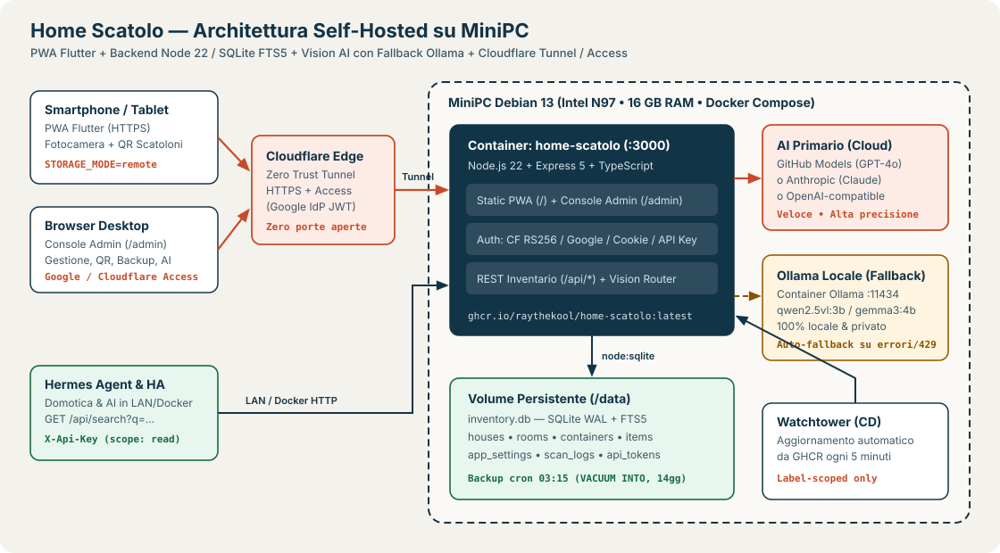
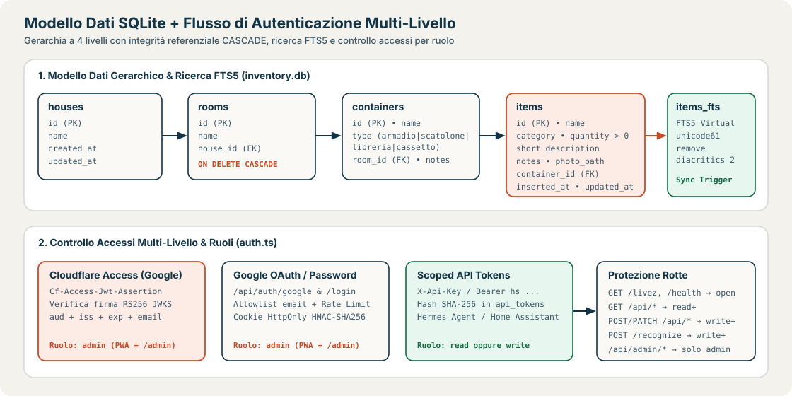
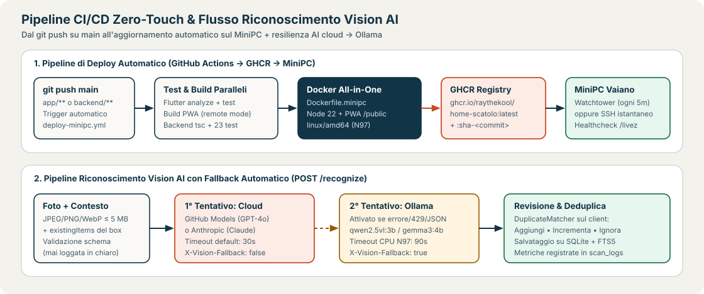

# 🏗️ Documentazione Tecnica — Home Scatolo

> **Architettura (Explanation) e Riferimento Completo (Reference)** per sviluppatori e amministratori del MiniPC self-hosted.

---

## 🗂️ Sommario

1. [💡 Architettura del Sistema](#-architettura-del-sistema)
2. [🗄️ Modello Dati & SQLite FTS5](#️-modello-dati--sqlite-fts5)
3. [🧠 Pipeline Vision AI & Fallback Automatico](#-pipeline-vision-ai--fallback-automatico)
4. [🔐 Autenticazione e Sicurezza](#-autenticazione-e-sicurezza)
5. [📖 Riferimento API REST](#-riferimento-api-rest)
6. [🚀 Pipeline CI/CD & Deploy MiniPC](#-pipeline-cicd--deploy-minipc)
7. [⚙️ Riferimento Variabili d'Ambiente (`.env`)](#️-riferimento-variabili-dambiente-env)
8. [🎨 Design System & Temi Light/Dark](#-design-system--temi-lightdark)
9. [🧪 Sviluppo Locale & Test Suite](#-sviluppo-locale--test-suite)

---

## 💡 Architettura del Sistema

Home Scatolo è progettato come **applicazione monorepo leggera e auto-contenuta**, ottimizzata per hardware compatto a basso consumo (es. MiniPC Debian 13, Intel N97, 16 GB RAM) in affiancamento a Docker, Ollama, Home Assistant, Hermes Agent e Cloudflare Tunnel.



### Decisioni architetturali chiave

| Componente | Scelta tecnologica | Motivazione |
| :--- | :--- | :--- |
| **Runtime Backend** | Node.js 22 + Express 5 + TypeScript ESM (`tsx`) | Un solo processo leggero (~60 MB RAM), nessun passaggio di transpilazione JS richiesto in produzione, supporto nativo a `node:sqlite` e `AbortSignal.timeout`. |
| **Database** | **`node:sqlite` (`DatabaseSync`)** in modalità `WAL` + `FTS5` | **Zero dipendenze native C++/node-gyp** su `node:22-alpine`, singolo file persistente `/data/inventory.db`, backup a caldo sicuro via `VACUUM INTO`, prestazioni istantanee per decine di migliaia di oggetti. |
| **Frontend PWA** | Flutter 3.x Web (`STORAGE_MODE=remote`, `API_BASE_URL=`) | Servita direttamente dal backend sullo stesso origin (`/`) → zero CORS, zero segreti nel bundle JS, condivisione nativa del cookie `HttpOnly` e pieno supporto fotocamera HTTPS dietro Cloudflare Tunnel. |
| **Console `/admin`** | HTML5 semantico + CSS moderno + ES Modules vanilla (`qr.js` puro) | Zero bundler o dipendenze CDN, LCP < 100ms in LAN, accessibile (WCAG AA+, `<dialog>` nativi), CSP restrittiva e stampa QR `@media print`. |
| **AI Vision** | Catena `VisionProvider` con fallback automatico | Qualità e velocità dal cloud (GitHub Models / Claude) con continuità garantita offline/rate-limit grazie a **Ollama** già attivo sul MiniPC. |
| **Aggiornamenti** | GitHub Actions → GHCR (`linux/amd64`) → Watchtower label-scoped | Zero compilazioni sull'N97, zero porte SSH aperte sul router, isolamento totale rispetto agli altri container del MiniPC. |

---

## 🗄️ Modello Dati & SQLite FTS5

Il database (`backend/src/db.ts`) applica `PRAGMA journal_mode = WAL`, `PRAGMA foreign_keys = ON` e `PRAGMA busy_timeout = 5000`.



### Tabelle principali

| Tabella | Colonne principali | Vincoli & Note |
| :--- | :--- | :--- |
| `houses` | `id`, `name`, `created_at`, `updated_at` | Radice multi-casa |
| `rooms` | `id`, `name`, `house_id`, `created_at`, `updated_at` | `FOREIGN KEY (house_id) REFERENCES houses(id) ON DELETE CASCADE` |
| `containers` | `id`, `name`, `type`, `room_id`, `notes`, `created_at`, `updated_at` | `type IN ('armadio','scatolone','libreria','cassetto')`, `ON DELETE CASCADE` |
| `items` | `id`, `name`, `category`, `short_description`, `notes`, `photo_path`, `container_id`, `inserted_at`, `updated_at`, `quantity` | `quantity > 0`, `ON DELETE CASCADE` |
| `items_fts` | Virtual table **FTS5** (`name`, `category`, `short_description`, `notes`) | `tokenize='unicode61 remove_diacritics 2'` (cercare `caffe` trova `Caffè`), sincronizzata via trigger `AFTER INSERT/UPDATE/DELETE` |
| `app_state` | `key` (PK), `value` | Stato applicativo condiviso (es. `activeHouseId`) |
| `app_settings` | `key` (PK), `value`, `updated_at` | Override runtime AI/prompt modificabili da `/admin` (mai segreti) |
| `scan_logs` | `id`, `created_at`, `provider`, `used_fallback`, `latency_ms`, `items_count`, `status`, `error_code` | Telemetria sintetica (retention automatica ultime 200 scansioni; zero immagini) |
| `api_tokens` | `id`, `name`, `prefix`, `token_hash` (SHA-256), `scope` (`read`/`write`), `created_at`, `last_used_at` | Token dedicati per integrazioni LAN (Hermes Agent, Home Assistant) |

---

## 🧠 Pipeline Vision AI & Fallback Automatico

Implementata in `backend/src/vision/providers.ts` e `backend/src/recognition.ts`:



### Provider supportati (`AI_PRIMARY_PROVIDER` / `AI_FALLBACK_PROVIDER`)

| Identificativo | Endpoint / SDK | Note |
| :--- | :--- | :--- |
| `github-models` | `https://models.github.ai/inference/chat/completions` | Ideale come primario con GitHub Copilot (`openai/gpt-4o`) |
| `anthropic` | `https://api.anthropic.com/v1/messages` | Supporto nativo Claude Vision (`claude-sonnet-4-5`) |
| `openai-compatible` | `${OPENAI_BASE_URL}/chat/completions` | Compatibile con OpenAI, OpenRouter, Gemini OpenAI-compat, vLLM |
| `ollama` | `${OLLAMA_BASE_URL}/api/chat` (`format: "json"`, `stream: false`) | Fallback locale privato su MiniPC (`qwen2.5vl:3b` o `gemma3:4b`, timeout 90s) |
| `azure-foundry` | Azure OpenAI via `DefaultAzureCredential` (`foundry_client.ts`) | Mantenuto per retrocompatibilità |

### Garanzie di resilienza e privacy
- **Estrazione JSON tollerante**: `extractJsonObject()` gestisce sia JSON puro sia blocchi racchiusi in markdown fence (`` ```json ... ``` ``).
- **Validazione rigorosa + fallback su output malformato**: se il provider primario va in timeout, risponde `429`/`5xx`, o restituisce JSON non conforme allo schema `RecognitionResult`, `recognizeWithFallback()` tenta automaticamente il provider successivo.
- **Osservabilità via header**: ogni risposta `POST /recognize` espone `X-Vision-Provider` e `X-Vision-Fallback` (`true`/`false`).
- **Zero data leak nei log**: le immagini Base64, gli header `Authorization` e i segreti non vengono mai loggati né persistiti in `scan_logs`.

---

## 🔐 Autenticazione e Sicurezza

Implementata in `backend/src/auth.ts` e `backend/src/routes/auth.ts` con modello **RBAC a 3 livelli** (`read` < `write` < `admin`):

1. **Cloudflare Access JWT (RS256)**:
   - Legge `Cf-Access-Jwt-Assertion` (o cookie `CF_Authorization`) quando `CF_ACCESS_TEAM_DOMAIN` e `CF_ACCESS_AUD` sono impostati.
   - Scarica e mette in cache per 1 ora le chiavi pubbliche JWKS da `https://<team>/cdn-cgi/access/certs` (con auto-refresh su `kid` sconosciuto) e verifica crittograficamente firma **RS256**, `aud`, `iss`, `exp`, `nbf` e (se presente) `AUTH_ALLOWED_EMAILS`.
2. **Google OAuth 2.0 diretto**:
   - `GET /api/auth/google` emette uno `state` firmato HMAC in cookie `HttpOnly` contro attacchi CSRF.
   - `GET /api/auth/google/callback` verifica lo `state`, scambia il codice, controlla `email_verified === true` e la presenza nell'allowlist obbligatoria `AUTH_ALLOWED_EMAILS`, quindi emette il cookie di sessione `hs_session`.
3. **Password / Master Token + Session Cookie `HttpOnly`**:
   - Confronto constant-time tramite `crypto.timingSafeEqual` su digest SHA-256.
   - Rate limiter anti brute-force su `POST /api/auth/login` (max 10 tentativi falliti per IP in 15 minuti → HTTP `429`).
   - Cookie `hs_session` firmato HMAC-SHA256 (`HttpOnly; SameSite=Lax; Secure` dietro HTTPS/`X-Forwarded-Proto: https`).
4. **Scoped API Tokens (`api_tokens`)**:
   - Generati con 192 bit di entropia (`hs_<48 hex>`), salvati solo come hash SHA-256.
   - Un token `read` può accedere solo a `GET /api/*` (bloccato con `403` su mutazioni, `/recognize` e `/api/admin/*`).
5. **Hardening Web su `/admin`**:
   - `Content-Security-Policy` restrittiva (`script-src 'self'`, `frame-ancestors 'none'`), `X-Frame-Options: DENY`, `X-Content-Type-Options: nosniff`, `Referrer-Policy: same-origin` e costruzione DOM XSS-safe senza `innerHTML`.

---

## 📖 Riferimento API REST

### Salute & Sistema (pubblici)

| Metodo | Percorso | Descrizione |
| :--- | :--- | :--- |
| `GET` | `/livez` | Liveness probe Docker (`200` se Express + SQLite attivi) |
| `GET` | `/health` | Readiness check PWA (`200` se DB ok e almeno 1 provider AI configurato, altrimenti `503`) |

### Autenticazione (`/api/auth/*`)

| Metodo | Percorso | Descrizione |
| :--- | :--- | :--- |
| `GET` | `/api/auth/config` | Metodi di login abilitati (`password`, `google`, `cloudflare`) |
| `GET` | `/api/auth/session` | Stato sessione corrente (`authenticated`, `role`, `method`, `subject`) |
| `POST` | `/api/auth/login` | Login con `{ "password": "..." }` → imposta cookie `hs_session` |
| `POST` | `/api/auth/logout` | Invalida cookie `hs_session` |
| `GET` | `/api/auth/google` | Avvia flusso Google OAuth 2.0 |
| `GET` | `/api/auth/google/callback` | Callback Google OAuth 2.0 |

### Inventario & Riconoscimento (`GET` richiede `read+`; mutazioni e `/recognize` richiedono `write+`)

| Metodo | Percorso | Descrizione |
| :--- | :--- | :--- |
| `GET` / `POST` | `/api/houses` | Elenca o crea una casa (`{ name }`) |
| `PATCH` / `DELETE` | `/api/houses/:id` | Rinomina o elimina casa (cascata) |
| `GET` / `POST` | `/api/houses/:houseId/rooms` · `/api/rooms` | Elenca o crea stanze (`{ name, houseId }`) |
| `PATCH` / `DELETE` | `/api/rooms/:id` | Modifica o elimina stanza |
| `GET` / `POST` | `/api/rooms/:roomId/containers` · `/api/containers` | Elenca o crea contenitori (`{ name, type, roomId, notes? }`) |
| `PATCH` / `DELETE` | `/api/containers/:id` | Modifica o elimina contenitore |
| `POST` | `/api/quick-scan-container` | Crea o riusa `La mia casa / Ingresso / Da ordinare` |
| `GET` / `POST` | `/api/containers/:containerId/items` · `/api/items` | Elenca o crea oggetti |
| `GET` / `PATCH` / `DELETE` | `/api/items/:id` | Dettaglio arricchito, modifica/spostamento `containerId` o eliminazione |
| `POST` | `/api/items/:id/increment` | Incrementa quantità (`{ amount }`) |
| `GET` | `/api/search?q=...&houseId=...&category=...` | Ricerca FTS5 + LIKE con percorso `houseName`, `roomName`, `containerName` |
| `GET` / `PUT` | `/api/state/:key` | Legge o salva stato condiviso (es. `activeHouseId`) |
| `GET` | `/api/export` | Export JSON completo dell'inventario |
| `POST` | `/recognize` · `/api/recognize` | Analisi immagine Vision AI (`{ imageBase64, mimeType, existingItems }`) |

### Amministrazione (`/api/admin/*` — richiede ruolo `admin`)

| Metodo | Percorso | Descrizione |
| :--- | :--- | :--- |
| `GET` | `/api/admin/overview` | Statistiche DB, catena provider AI, stato auth e ultime 50 scansioni |
| `GET` | `/api/admin/tree` | Albero `houses → rooms → containers` con `itemCount` e `totalQuantity` |
| `GET` | `/api/admin/items` | Tutti gli oggetti arricchiti con il percorso completo |
| `GET` | `/api/admin/ollama/models` | Query live a `${OLLAMA_BASE_URL}/api/tags` |
| `GET` / `PUT` | `/api/admin/settings` | Lettura e aggiornamento runtime di provider, modello Ollama, timeout e prompt |
| `GET` | `/api/admin/backup/sqlite` | Download snapshot consistente SQLite via `VACUUM INTO` |
| `GET` | `/api/admin/export/csv` | Download CSV UTF-8 (con BOM per Excel) |
| `POST` | `/api/admin/import?dryRun=true\|false` | Anteprima o importazione transazionale da JSON |
| `POST` | `/api/admin/maintenance/integrity` | Esegue `PRAGMA integrity_check` |
| `POST` | `/api/admin/maintenance/rebuild-fts` | Ricostruisce l'indice virtuale `items_fts` |
| `GET` / `POST` / `DELETE` | `/api/admin/tokens` · `/api/admin/tokens/:id` | Lista, genera o revoca token API scoped (`read` / `write`) |

---

## 🚀 Pipeline CI/CD & Deploy MiniPC

- **Workflow principale**: [.github/workflows/deploy-minipc.yml](../.github/workflows/deploy-minipc.yml)
  - Su ogni push a `main`: esegue in parallelo `test-and-build-pwa` (Flutter analyze, test, build `STORAGE_MODE=remote` same-origin) e `test-backend` (Node 22 `npm run build && npm test`), poi costruisce [Dockerfile.minipc](../Dockerfile.minipc) per `linux/amd64` e pubblica su `ghcr.io/raythekool/home-scatolo:latest` e `:sha-<commit>`.
- **Auto-update sul MiniPC**:
  - **Modalità default (Watchtower)**: [docker-compose.minipc.yml](../docker-compose.minipc.yml) esegue `containrrr/watchtower` con `WATCHTOWER_LABEL_ENABLE=true` (aggiorna esclusivamente `home-scatolo` ogni 5 minuti e rimuove le vecchie immagini).
  - **Modalità istantanea (SSH opzionale)**: impostando la variable GitHub `MINIPC_DEPLOY_MODE=ssh` e i secrets `MINIPC_SSH_HOST`, `MINIPC_SSH_USER`, `MINIPC_SSH_KEY`, il workflow aggiorna il MiniPC subito a fine build e verifica `/livez`.
- **Bootstrap one-shot**: [scripts/bootstrap-minipc.sh](../scripts/bootstrap-minipc.sh) prepara directory `/opt/home-scatolo`, `.env` (con `APP_API_TOKEN` generato via `openssl`), pull di `qwen2.5vl:3b` su Ollama se presente, avvio stack e cron backup notturno SQLite (03:15, retention 14 giorni).
- **Workflow legacy**: [deploy-backend.yml](../.github/workflows/deploy-backend.yml) (Azure Container Apps) è configurato solo su `workflow_dispatch` manuale.

---

## ⚙️ Riferimento Variabili d'Ambiente (`.env`)

Template completo in [backend/.env.example](../backend/.env.example):

| Variabile | Default | Scopo |
| :--- | :--- | :--- |
| `PORT` | `3000` | Porta HTTP del server Express |
| `DB_PATH` | `./data/inventory.db` | Percorso file SQLite (in Docker: `/data/inventory.db`) |
| `PUBLIC_WEB_DIR` | *(vuoto)* | Cartella build Flutter Web da servire su `/` (in Docker MiniPC: `/app/public`) |
| `ALLOWED_ORIGINS` | `http://localhost:8080,http://localhost:3000` | Origini CORS consentite (separate da virgola) |
| `APP_API_TOKEN` | *(vuoto)* | Token API master (ruolo `admin`, Bearer / `X-Api-Key`) |
| `ADMIN_PASSWORD` | `APP_API_TOKEN` | Password dedicata per login web `/admin` |
| `SESSION_SECRET` | *(derivato)* | Segreto HMAC per firma cookie `hs_session` |
| `SESSION_TTL_SECONDS` | `2592000` (30 gg) | Durata sessione cookie web |
| `CF_ACCESS_TEAM_DOMAIN` | *(vuoto)* | Dominio team Cloudflare Access (es. `tuoteam.cloudflareaccess.com`) |
| `CF_ACCESS_AUD` | *(vuoto)* | Application Audience Tag Cloudflare Access |
| `GOOGLE_CLIENT_ID` / `GOOGLE_CLIENT_SECRET` | *(vuoto)* | Credenziali Google OAuth 2.0 diretto |
| `GOOGLE_REDIRECT_URI` | *(auto da Host)* | Override opzionale callback OAuth |
| `AUTH_ALLOWED_EMAILS` | *(vuoto)* | Allowlist email (comma-separated); obbligatoria per Google OAuth |
| `AI_PRIMARY_PROVIDER` | *(auto)* | `github-models` \| `anthropic` \| `openai-compatible` \| `ollama` \| `azure-foundry` |
| `AI_FALLBACK_PROVIDER` | `ollama` *(se configurato)* | Provider secondario o `none` |
| `GITHUB_MODELS_TOKEN` / `GITHUB_MODELS_MODEL` | `openai/gpt-4o` | Credenziali e modello GitHub Models |
| `ANTHROPIC_API_KEY` / `ANTHROPIC_MODEL` | `claude-sonnet-4-5` | Credenziali e modello Anthropic |
| `OPENAI_BASE_URL` / `OPENAI_API_KEY` / `OPENAI_MODEL` | *(vuoto)* | Endpoint generico OpenAI-compatible |
| `OLLAMA_BASE_URL` / `OLLAMA_MODEL` | `http://host.docker.internal:11434` / `qwen2.5vl:3b` | Istanza Ollama locale di fallback |
| `AI_TIMEOUT_MS` / `OLLAMA_TIMEOUT_MS` | `30000` / `90000` | Timeout chiamate AI in millisecondi |

### Flag di compilazione Flutter (`--dart-define`)

| Flag | Default | Scopo |
| :--- | :--- | :--- |
| `STORAGE_MODE` | `local` | `local` (SQLite locale) oppure `remote` (REST API sul MiniPC via `RemoteStorageService`) |
| `API_BASE_URL` | `http://localhost:3000` | URL backend (vuoto `""` per same-origin quando la PWA è servita dal backend) |
| `API_TOKEN` | `""` | Token Bearer opzionale (non necessario quando autenticato via cookie `HttpOnly` o Cloudflare Access) |

---

## 🎨 Design System & Temi Light/Dark

Frontend Flutter e console `/admin` condividono gli stessi token cromatici (WCAG AA+), documentati nel file [Figma Home Scatolo — UI & Design System](https://www.figma.com/design/dg84yVcT8nvTzX82zudH7g) (variabili `Home Scatolo Tokens` con `codeSyntax` CSS, 6 Main Components, 4 schermate PWA e 3 viste Admin).

| Token | ☀️ Light — Indaco & Grafite | 🌙 Dark — Notte & Ambra |
| :--- | :--- | :--- |
| `paper` (sfondo) | `#F4F6FA` | `#11161D` |
| `surface` (card) | `#FFFFFF` | `#19212B` |
| `ink` / `ink-soft` | `#151B2E` / `#4C5772` | `#F1F5F9` / `#9FB0C3` |
| `accent` (CTA) | `#3B5BDB` (testo `#FFF`, 5.67:1) | `#E07A3F` (testo `#11161D`, 6.11:1) |
| `accent-soft` | `#E8EEFF` | `#332219` |
| `border` | `#DCE1EC` | `#2E3B4A` |
| `ok` / `ok-bg` | `#127A4E` / `#E4F7EE` | `#34D399` / `#132E24` |

- **Flutter**: [app/lib/theme/app_theme.dart](../app/lib/theme/app_theme.dart) espone `AppTheme.light`, `AppTheme.dark`, `AppThemeController` (`ValueNotifier<ThemeMode>`, default `ThemeMode.system`) e il widget `ThemeToggleButton` presente nelle AppBar; collegati in [main.dart](../app/lib/main.dart) con `ValueListenableBuilder`.
- **Admin `/admin`**: variabili CSS in [styles.css](../backend/src/admin/public/styles.css) (`:root` light, `:root[data-theme='dark']` e `@media (prefers-color-scheme: dark)` come fallback); pulsante `#theme-toggle` in [app.js](../backend/src/admin/public/app.js) (`initTheme()`, `localStorage` chiave `hs_theme`, `aria-pressed`). Etichette QR e `@media print` forzano sempre carta bianca per la leggibilità dei codici.
- **Test**: [theme_toggle_test.dart](../app/test/theme_toggle_test.dart) verifica lo switch Light ↔ Dark e i token dei due `ThemeData`.

---

## 🧪 Sviluppo Locale & Test Suite

### Backend (`backend/`)

```bash
cd backend
npm install
npm run build   # Type-check strict TypeScript (tsc --noEmit)
npm test        # 25 test (node:test): DB, FTS5, Vision + fallback, Auth RS256/OAuth/Tokens, Admin APIs
npm run dev     # Server con live reload (tsx watch)
```

Copertura test attuale (`backend/test/`):
- `db.test.ts` — gerarchia, `ON DELETE CASCADE`, quick scan, FTS5 con diacritici e filtri, export.
- `vision_providers.test.ts` — builder GitHub Models/Anthropic/Ollama, parsing JSON fenced, auto-resolution e fallback HTTP.
- `api.test.ts` — REST CRUD end-to-end, `APP_API_TOKEN`, static SPA serving.
- `admin_auth.test.ts` — login cookie `HttpOnly`, verifica crittografica RS256 Cloudflare Access con chiavi RSA generate in test, Google OAuth 2.0 + allowlist, token scoped `read`/`write`, backup `VACUUM INTO`, CSV, JSON import dry-run/apply, Ollama `/api/tags`, scan logs e header di sicurezza `/admin`.
- `recognition.test.ts` e `foundry_client.test.ts` — validazione payload e client Azure AI Foundry.

### Frontend (`app/`)

```bash
cd app
flutter pub get
flutter analyze
flutter test
```

### Agenti QA automatici e contratto API

```bash
./.agents/skills/backend-tester/scripts/run-backend-qa.sh    # tsc + 25 test + sintassi admin + leak check log
./.agents/skills/frontend-tester/scripts/run-frontend-qa.sh  # parità StorageService, label form, XSS sink
```

Il contratto API eseguibile è in [postman/collections/home-scatolo-api](../postman/collections/home-scatolo-api/) (8 richieste con assertion) con gli environment `Local Dev` e `MiniPC Vaiano`.
