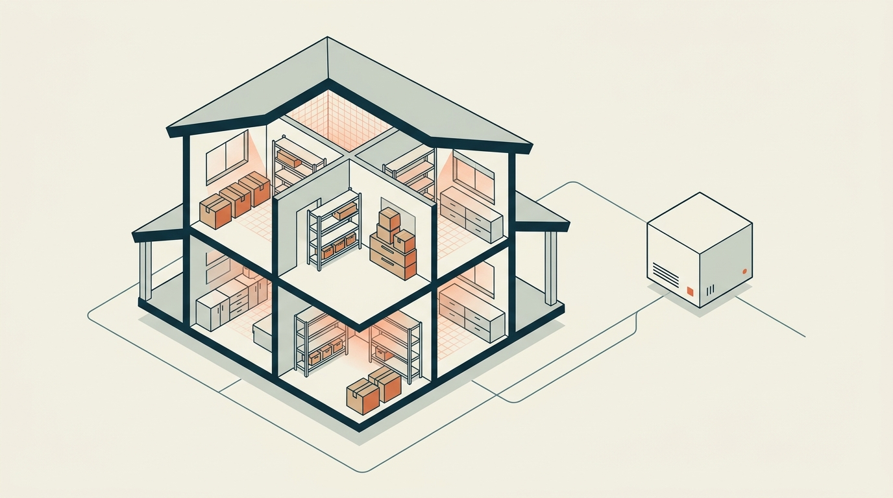
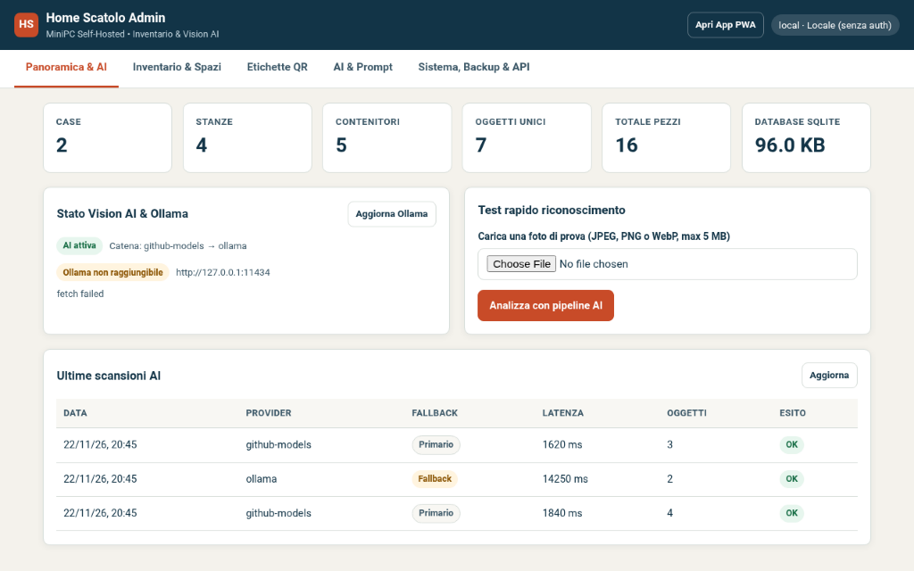
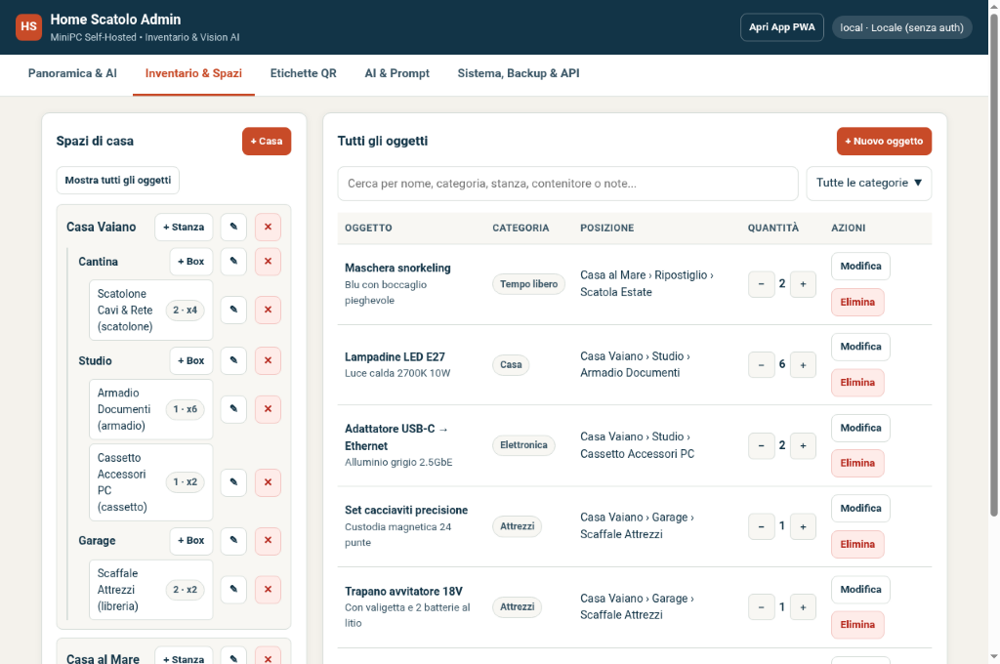
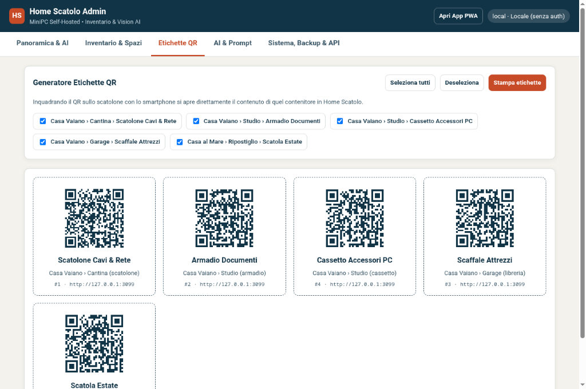
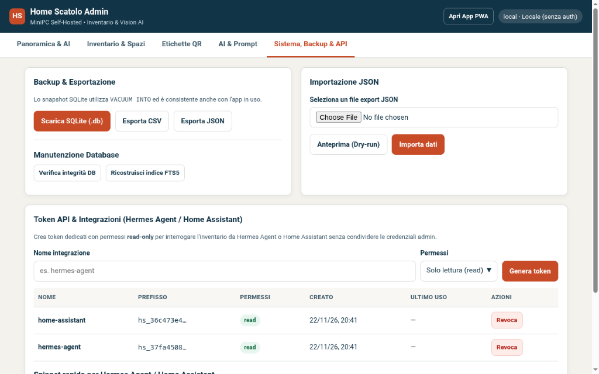

# 📘 Guida d'Uso — Home Scatolo

> **Tutorial pratici e guide operative (How-to)** per catalogare gli oggetti di casa, trovare qualsiasi cosa in pochi secondi, stampare etichette QR per gli scatoloni e gestire il tuo server casalingo dalla console `/admin`.



---

## 🗂️ Sommario

1. [🎓 Tutorial: Cataloga il tuo primo scatolone in 5 minuti](#-tutorial-cataloga-il-tuo-primo-scatolone-in-5-minuti)
2. [🖥️ Esplorare la Console Amministrativa (`/admin`)](#️-esplorare-la-console-amministrativa-admin)
3. [🛠️ Guide Pratiche (How-to)](#️-guide-pratiche-how-to)
   - [🎨 Cambiare tema Light / Dark (Indaco & Grafite / Notte & Ambra)](#-come-cambiare-tema-chiaro--scuro)
   - [🔐 Accedere con Google o Cloudflare Access](#-come-accedere-con-google-o-cloudflare-access)
   - [🏷️ Stampare e applicare etichette QR sugli scatoloni](#️-come-stampare-etichette-qr-per-gli-scatoloni)
   - [🧠 Scegliere il modello AI o cambiare prompt senza riavviare](#-come-regolare-ai-modello-ollama-e-prompt)
   - [💾 Fare backup, esportare in Excel (CSV) o ripristinare dati](#-come-fare-backup-esportare-in-csv-o-importare-dati)
   - [🤖 Chiedere a Hermes Agent / Home Assistant "dove ho messo X?"](#-come-collegare-hermes-agent-e-home-assistant)
4. [❓ Risoluzione problemi frequenti](#-risoluzione-problemi-frequenti)

---

## 🎓 Tutorial: Cataloga il tuo primo scatolone in 5 minuti

Home Scatolo organizza tutto con una struttura intuitiva a **4 livelli**:

> 🏠 **Casa** *(es. Casa Vaiano)* → 🚪 **Stanza** *(es. Cantina)* → 📦 **Contenitore** *(es. Scatolone Cavi)* → 🔧 **Oggetto** *(es. Cavo HDMI 2.1, x3)*

### Passo 1 — Apri l'app sul telefono 📱
Visita l'indirizzo del tuo server (es. `https://scatolo.tuodominio.it`) dal browser dello smartphone. Puoi anche installarla nella schermata Home come **PWA** (*Aggiungi a schermata Home*).

### Passo 2 — Scansione immediata o scelta del contenitore 📷
- **Modalità lampo**: se non hai ancora creato stanze, tocca **Scansiona subito**. L'app prepara automaticamente `La mia casa › Ingresso › Da ordinare` così non perdi tempo.
- **Modalità ordinata**: entra in `Casa → Stanza → Contenitore` e tocca l'icona di scansione sul contenitore desiderato.

### Passo 3 — Scatta la foto e lascia lavorare l'AI ✨
1. Attendi il badge verde **Riconoscimento pronto**.
2. Tocca **Scatta foto** (oppure **Scegli dalla galleria**, max 5 MB, JPEG/PNG/WebP).
3. Premi **Analizza foto**: il backend interroga il modello cloud (es. GPT-4o / Claude) e, se temporaneamente non disponibile, usa automaticamente **Ollama** sul tuo MiniPC.

### Passo 4 — Rivedi e conferma i duplicati ✅
Prima di salvare, Home Scatolo confronta gli oggetti riconosciuti con quelli già presenti nello stesso contenitore e ti propone l'azione migliore per ciascuno:
- ➕ **Aggiungi come nuovo** — oggetto mai registrato prima in quel box.
- 🔢 **Incrementa quantità esistente** — oggetto già presente (es. altri 2 cavi HDMI → quantità aggiornata in automatico).
- 🚫 **Ignora** — scarta eventuali falsi positivi o elementi di sfondo.

Premi **Conferma modifiche**: l'inventario è salvato istantaneamente nel database del MiniPC ed è visibile da tutti i dispositivi!

### Passo 5 — Cerca, modifica o sposta gli oggetti 🔎
- Tocca l'icona **lente di ingrandimento** nella barra in alto di **Case** o **Inventario** per cercare in tutta la casa: ogni risultato mostra il percorso completo (`Casa › Stanza › Contenitore`).
- Tocca un oggetto qualsiasi per aprire la **scheda di dettaglio**, regolare la quantità con `−` / `+`, aggiornare nome/note o **spostarlo in un altro contenitore**.

---

## 🖥️ Esplorare la Console Amministrativa (`/admin`)

Quando lavori da PC o tablet, apri `https://scatolo.tuodominio.it/admin` per una vista completa e velocissima su tutto ciò che hai in casa.

### 1. 📊 Panoramica & AI
Mostra a colpo d'occhio quanti spazi e oggetti hai catalogato, la dimensione del database SQLite, lo stato della catena AI (`primario → fallback`), lo stato live di **Ollama**, un box per testare subito una foto e lo **storico delle ultime scansioni** (con provider usato, latenza in ms ed eventuale fallback).



### 2. 🗃️ Inventario & Spazi
A sinistra trovi l'albero completo **Casa → Stanza → Contenitore** con i contatori (`oggetti · totale pezzi`) e i pulsanti per creare, rinominare o eliminare spazi.
A destra trovi la **tabella globale degli oggetti** con:
- 🔎 **Ricerca istantanea** su nome, categoria, stanza, contenitore, descrizione e note;
- 🏷️ **Filtro per categoria**;
- ➖ / ➕ **Modifica quantità in un clic**;
- ✏️ **Modifica e spostamento**: apri la scheda oggetto per cambiare nome, note o **spostarlo in un altro contenitore** quando riordini casa;
- ➕ **Inserimento manuale**: aggiungi oggetti anche senza fare foto.



### 3. 🏷️ Etichette QR
Seleziona uno o più contenitori (es. tutti gli scatoloni della cantina) e clicca **Stampa etichette**: la pagina si formatta automaticamente in una griglia di stampa pulita con linee tratteggiate di ritaglio.



### 4. ⚙️ Sistema, Backup & API
Unico punto per scaricare backup SQLite a caldo, esportare in CSV/JSON, importare dati con anteprima dry-run, verificare l'integrità del database e creare **token API dedicati** per le tue automazioni domestiche.



---

## 🛠️ Guide Pratiche (How-to)

### 🎨 Come cambiare tema chiaro / scuro

Sia la **PWA Flutter** sia la **Console `/admin`** supportano due temi WCAG AA+ coordinati:
- **☀️ Light — Indaco & Grafite**: fondo chiaro `#F4F6FA` con accento indaco `#3B5BDB` (ideale di giorno e alla luce naturale).
- **🌙 Dark — Notte & Ambra**: fondo scuro `#11161D` con card `#19212B` e accento ambra `#E07A3F` (ideale di sera, in cantina o in garage).

Come cambiare tema al volo:
- **Sullo smartphone (PWA)**: tocca l'icona **🌙 / ☀️** nella barra in alto delle schermate principali (`Case`, `Stanze`, `Contenitori`, `Inventario`). Di default l'app segue il tema del sistema operativo.
- **Da desktop (`/admin`)**: clicca il pulsante **🌙 Scuro / ☀️ Chiaro** nella barra blu in alto a destra. La scelta viene salvata nel browser (`localStorage`). Le **etichette QR** e la stampa A4 restano sempre su fondo bianco ad alto contrasto per garantire una scansione perfetta con lo smartphone.

---

### 🔐 Come accedere con Google o Cloudflare Access

A seconda di come hai configurato il MiniPC, hai tre modalità di accesso:

1. **☁️ Google tramite Cloudflare Access *(consigliata)***:
   - Aprendo `https://scatolo.tuodominio.it` o `/admin` vieni autenticato da Cloudflare con il tuo account Google.
   - Una volta autenticato, entri **direttamente** sia nella PWA sia in `/admin` (vedrai la tua email in alto a destra nella barra blu) senza dover digitare altre password.
2. **🔵 Pulsante "Accedi con Google" *(OAuth diretto)***:
   - Se hai configurato `GOOGLE_CLIENT_ID` nel `.env`, clicca **Accedi con Google** nella schermata di login di `/admin`.
   - Solo le email elencate in `AUTH_ALLOWED_EMAILS` possono entrare.
3. **🔑 Password locale *(LAN / emergenza)***:
   - Inserisci la tua `ADMIN_PASSWORD` (o `APP_API_TOKEN`) nel modulo di `/admin`. La sessione resta attiva nel browser tramite cookie sicuro `HttpOnly`.

> 💡 **Suggerimento**: dopo aver effettuato il login su `/admin`, anche la PWA aperta sullo stesso browser/dominio usa automaticamente la stessa sessione autenticata.

---

### 🏷️ Come stampare etichette QR per gli scatoloni

1. Apri `/admin` e vai nella tab **Etichette QR**.
2. Spunta i contenitori che vuoi etichettare (oppure premi **Seleziona tutti**).
3. Clicca **Stampa etichette** (o `Ctrl+P` / `Cmd+P`).
4. Stampa su foglio A4 adesivo o carta normale, ritaglia lungo il bordo tratteggiato e incolla sullo scatolone.
5. **Risultato**: quando inquadri il QR con la fotocamera dello smartphone, si apre direttamente la lista degli oggetti contenuti dentro quello scatolone senza doverlo aprire! 📦✨

---

### 🧠 Come regolare AI, modello Ollama e prompt

1. Apri `/admin` → tab **AI & Prompt**.
2. Scegli **Provider primario** (es. `GitHub Models` o `Anthropic`) e **Provider fallback** (`Ollama`).
3. Nel campo **Modello Ollama**, seleziona uno dei modelli già scaricati sul MiniPC dal menu a discesa (es. `qwen2.5vl:3b` o `gemma3:4b`).
4. Opzionale: personalizza il prompt di riconoscimento (mantieni il segnaposto `{{existingItems}}` affinché l'AI conosca gli oggetti già presenti nel contenitore).
5. Premi **Salva impostazioni AI**: le modifiche sono attive **immediatamente**, senza riavviare Docker.

---

### 💾 Come fare backup, esportare in CSV o importare dati

Nella tab **Sistema, Backup & API**:
- **📥 Scarica SQLite (`.db`)**: crea sul momento una copia consistente del database (`VACUUM INTO`) senza interrompere il servizio.
- **📊 Esporta CSV**: scarica un file apribile direttamente in Excel, LibreOffice Calc o Google Sheets con il percorso completo di ogni oggetto (`Casa, Stanza, Contenitore, Oggetto, Quantità, ...`).
- **📄 Esporta JSON**: utile per migrazioni o archiviazione leggibile.
- **📤 Importazione JSON**: seleziona un file JSON esportato e premi prima **Anteprima (Dry-run)** per verificare quanti elementi verrebbero aggiunti senza modificare nulla; poi premi **Importa dati**.
- **🩺 Manutenzione**: usa **Verifica integrità DB** o **Ricostruisci indice FTS5** se vuoi controllare lo stato del database.

---

### 🤖 Come collegare Hermes Agent e Home Assistant

Puoi permettere al tuo assistente casalingo di rispondere a domande come *"Dove ho messo il cavo HDMI?"* o *"Quante lampadine E27 ho in casa?"* **in sola lettura**, senza dargli accesso admin:

1. Vai in `/admin` → **Sistema, Backup & API**.
2. Nella sezione **Token API & Integrazioni**, inserisci il nome (es. `hermes-agent`), lascia permessi **Solo lettura (`read`)** e clicca **Genera token**.
3. Copia subito il token mostrato (`hs_...`, non sarà più visibile dopo).
4. Configura Hermes Agent o un `rest_command` / sensor su Home Assistant per chiamare l'endpoint locale sul MiniPC:

```bash
curl -H "X-Api-Key: hs_IL_TUO_TOKEN_READ" \
  "http://127.0.0.1:3000/api/search?q=hdmi"
```

Risposta JSON immediata con il percorso esatto:

```json
{
  "items": [
    {
      "id": 1,
      "name": "Cavo HDMI 2.1 (2m)",
      "category": "Elettronica",
      "quantity": 3,
      "houseName": "Casa Vaiano",
      "roomName": "Cantina",
      "containerName": "Scatolone Cavi & Rete",
      "containerType": "scatolone"
    }
  ]
}
```

---

## ❓ Risoluzione problemi frequenti

| Sintomo | Causa probabile | Soluzione rapida |
| :--- | :--- | :--- |
| 📷 La fotocamera non si apre sullo smartphone | L'app è aperta via `http://` invece di `https://` | Apri sempre l'app tramite il dominio **HTTPS** del Cloudflare Tunnel |
| 🔴 Banner *"Riconoscimento non disponibile"* | Nessun provider AI attivo o credenziali mancanti | Apri `/admin` → **Panoramica & AI** per verificare la catena provider e lo stato di Ollama |
| 🐢 La scansione impiega 15–40 secondi | Il provider cloud ha fallito ed è entrato in azione il fallback locale **Ollama** su CPU | Controlla **Ultime scansioni AI** in `/admin` (badge giallo `Fallback`) e verifica quota/token del provider cloud |
| 🚫 Errore `403` durante le chiamate API | Token `read` usato per una scrittura, oppure email Google non in `AUTH_ALLOWED_EMAILS` | Verifica lo scope del token in `/admin` o aggiungi la tua email in `AUTH_ALLOWED_EMAILS` nel `.env` |
